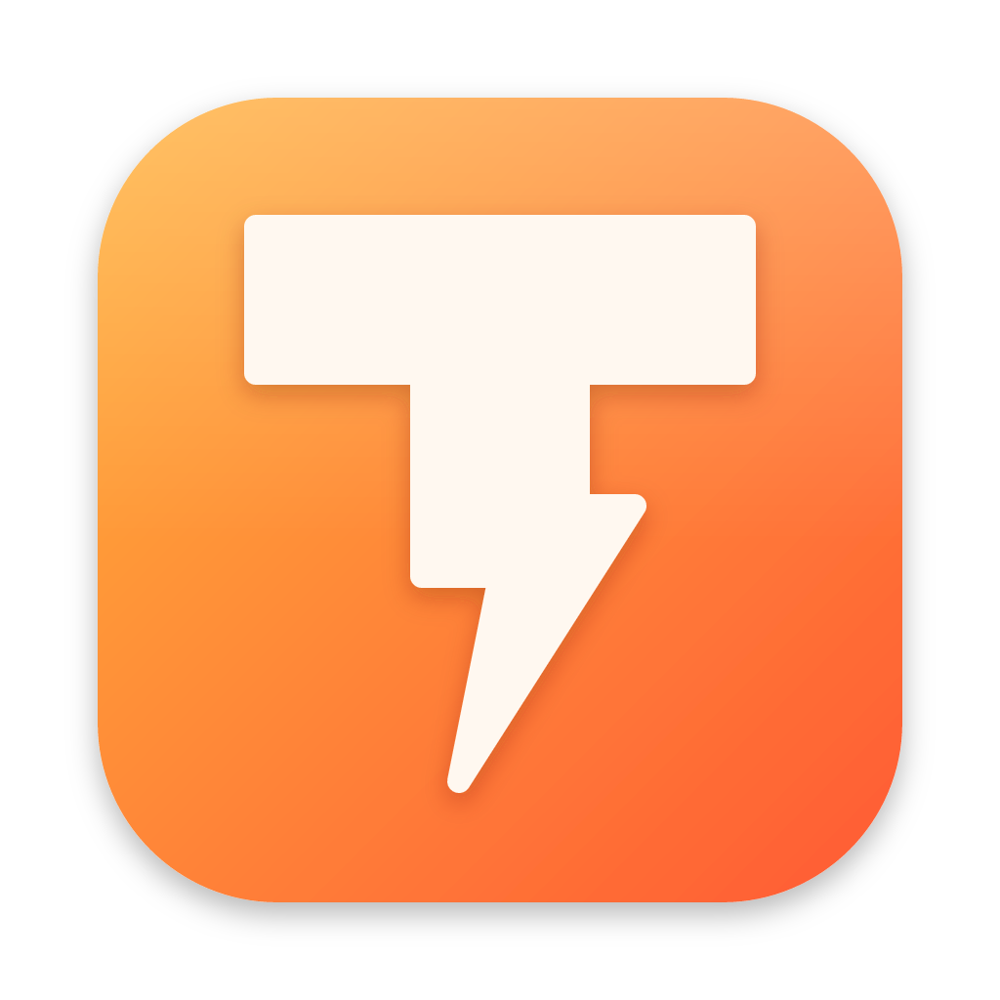

<p align="center">
  
</p>

<h1 align="center">Tap</h1>

[](https://github.com/timwuhaotian/tap/actions/workflows/ci.yml)
[](LICENSE)


A small, fast, quiet web browser for the Mac, written in Rust. Pages run on WebKit, the
engine already inside every Mac (Safari's), so there's no second browser engine to
download, update and keep in memory.

Tap is a port of [Search](https://github.com/driceroland/Search), an MIT-licensed Swift
browser by Office Commun. Search's behaviour is the specification. Tap rewrites all of
it in Rust (AppKit and WebKit through [`objc2`](https://github.com/madsmtm/objc2)),
with its own name and icon, and with fixes of its own.

> **Status: early.** Tap browses well and can be your Mac's browser, but much of
> Search isn't in yet (below). It updates itself; if yours never offers an update,
> download it once more. [`docs/PLAN.md`](docs/PLAN.md) is the plan; its parity tracker
> shows where each part stands.

**Download:** [`Tap-arm64.dmg`](https://github.com/timwuhaotian/tap/raw/main/releases/Tap-arm64.dmg)
· macOS 14 or later · Apple silicon · signed and notarized by Apple

## What it does now

- **One field** for addresses and searches. It suggests your visited pages by host,
  path or query, with a grey ending after the caret when it can finish an address.
  Tab or → takes the ending; Return uses what you typed unless you pick a suggestion.
  Pinyin and kana are left alone while an input method is composing.
- **Tabs across the top**, with the traffic lights in the row: ⌘T, ⌘W, ⇧⌘T, ⌃Tab,
  ⌘1–⌘9, links opened behind the page with ⌘-click, each tab with its site's icon
  (including sites whose only icon is an SVG); blank cached icons are fetched again.
- **An address bar** under the tabs, with back, forward and reload on its left: the
  page's address, a lock or a "Not secure" warning, the certificate a click away, and
  the load's progress as a line that glides forward and fades once the page is in.
  Settings can hide it.
- **Tab groups** in colours of their own: a group's name heads its tabs on a chip of
  its colour (right-click it to choose another), and a click folds it away or opens it.
- **Pick several tabs** with ⌘-click or ⇧-click: ⌘C copies their addresses, one to a
  line, ⌘W closes them, and a drag moves them together. Drag a tab to reorder it, onto
  another group to join it, or a group by its name; everything in the row glides where
  it goes, and a press anywhere in a tab's column takes the tab, not the window — the
  window itself is moved only by the row's empty ends, and a double click there zooms
  it to the screen and back. Tabs and address suggestions
  move on gentle springs, hover highlights fade in and out, and a pressed tab sinks
  and springs back, with less motion when your Mac asks for it.
- **Right-click a tab** to move it into a group (or a new one), rename it, reload,
  duplicate, copy its address (or a Markdown link), put it to sleep, close it, the ones
  to its right or all the others, or reopen a closed one; right-click a group's name to
  rename, fold, ungroup or close it. Right-click the empty tab row to reopen a closed tab.
- **Videos go full screen** from their player's own button, with Tap's window in
  full screen or not, and Esc twice brings them back when Settings asks for it.
- **Settings** (⌘,), laid out as Search's, with only the settings that work — 56
  rows (Search's 81, less translation, plus the address bar's): where new tabs go, what closing one lands on, background links that wait,
  closing tabs you leave alone, a fresh window at launch, sleeping tabs, the search
  engine (with suggestions and site shortcuts), "settings" or "new tab" typed in the
  field, asking where to save, videos that wait for a click, page zoom, light or dark
  (and pages that stay light, darkened), downloads, default browser, clearing data,
  updates. Blocking ads and trackers, reading mode (⇧⌘R), the floating video,
  120 Hz pages, middle-button scrolling and the tab bar's icons, reading progress
  and ⌘ numbers are all in there too.
- **Bring things over**: Settings › General › Bring Over imports passwords, bookmarks,
  history and open tabs from Chrome on this Mac. macOS asks for Chrome's keychain key
  to import passwords. Safari requires an exported browsing-data ZIP; Tap imports its
  supported passwords, bookmarks and history, but not open tabs. Safari exports may
  contain passwords in plain text: delete the file when you no longer need it. File…
  also takes a passwords CSV or a Tap profile backup.
- **Passwords**, Search's way, in the macOS keychain under Tap's name: click a sign-in
  box and the accounts kept for the site hang from it, one click fills it in; after a
  sign-in that took, Tap offers to save or update the password (or never ask on that
  site). Sign-in detection avoids unnecessary input scans as pages change. A page sent
  over plain http is only ever offered what was kept from one.
- **Your profile on your other Mac.** File › Export Tap Profile… writes one offline
  file of your tabs and their groups, history, bookmarks and settings, and offers it to
  AirDrop; open it on the other Mac and it all comes in, groups folded or open as they
  were. Sign-ins, passwords and cookies never go in the file.
- **It updates itself**: checked against Apple's notarization and the developer's
  signature, installed when Tap quits, or at once with Restart Now.
- **Tabs come back** where you left them, and cost nothing until you look at them.
- **Tabs you aren't using sleep** after half an hour and give their memory back; they
  wake on the same page, with Back and the scroll position. Never a tab playing sound,
  on a call, downloading or holding something you typed.
- **Find on page** (⌘F) with a live "3 of 17", Match Case and Whole Words.
- **Downloads** into Downloads, under their own names.
- **Pages can ask**: alerts, confirms, prompts, file uploads and site sign-ins, each
  titled with the site that asks.
- **It can be your browser.** Choose Tap under System Settings › Desktop & Dock ›
  Default web browser; links from other apps open in it, and so do HTML files.
- **New tabs pile up.** +/⌘T always opens a fresh blank tab instead of reusing the
  blank one in front; a blank tab shows a small rippling mark, and stays cheap with
  no web view. A tab's first page fades in from that mark, with the site's name under
  it, instead of flashing an empty white page.
- **A click on any tab lands in the field**, its address selected and ready to type.
- **Coding agents browse with it.** Tap puts a `tap` command in `~/.local/bin` and a
  skill where Claude Code, Codex, Gemini and opencode look, so an agent on this Mac
  reaches for Tap when a task needs a browser: `tap open`, `tap snapshot` (the page's
  controls, each with a ref), `tap click`, `tap fill`, `tap press`, `tap text`. Its tabs
  open behind yours, with your sign-ins. Settings › Let agents use Tap turns it off and
  takes the command and skill away.
- **Point an agent at a page.** Right-click a tab or a page for Copy Tab Details: the
  tab's id for `tap` (it lasts across restarts), its address, state and HTTP status,
  and what the page says of itself, to paste into an agent. Right-click anything on a
  page for Copy Element Details: its selector, box, style and markup. `tap info` gives
  an agent the same.
- **A page that keeps crashing stops reloading itself** and says so
  ([#849](https://github.com/driceroland/Search/pull/849)).
- **Nothing phones home.** No account, no sync, no telemetry. The only requests Tap
  makes on its own are the pages you open, their icons, and a look at this
  repository's `releases/latest.toml` every six hours for an update (Settings › About
  turns that off).

## Still to come

Everything else Search does, including:

- Bookmarks, the History page, private windows, and tabs down the side, pinned tabs,
  dragging a tab out of its group or out of the window, Spaces and profiles, two pages side by side, peeking at
  a link and the small window for links from other apps.
- **Hiding any element for good**, and Search's fuller dark-pages engine (Tap darkens a
  light page's colours; it doesn't sample the page as Search does).
- **A Passwords page** of Tap's own (Settings › Passwords › Open… shows them in
  Keychain Access meanwhile), **passkeys**, Apple's Passwords app under the sign-in
  box, and **Chrome extensions** on WebKit's own extension engine.
- **Extensions** imported from another browser.

## Building

You need a Mac with Apple silicon, Xcode, and Rust 1.94 or later:

```sh
cargo run -p tap-app          # debug build, straight from the tree
scripts/bundle.sh debug       # or a Tap.app in target/debug (graphite icon)
cargo xtask icon              # redraw the icon PNGs from packaging/icon.svg
```

A build you make yourself is signed ad hoc, so it runs only on your own Mac.

## Contributing

Issues and pull requests are welcome; see [CONTRIBUTING.md](CONTRIBUTING.md). Found a
security problem? Report it privately, as [SECURITY.md](SECURITY.md) explains.

## License

MIT; see [LICENSE](LICENSE). Tap includes work from Search, © 2026 Office Commun, under
the same license. "Search" and its icon belong to Office Commun; Tap uses neither.
